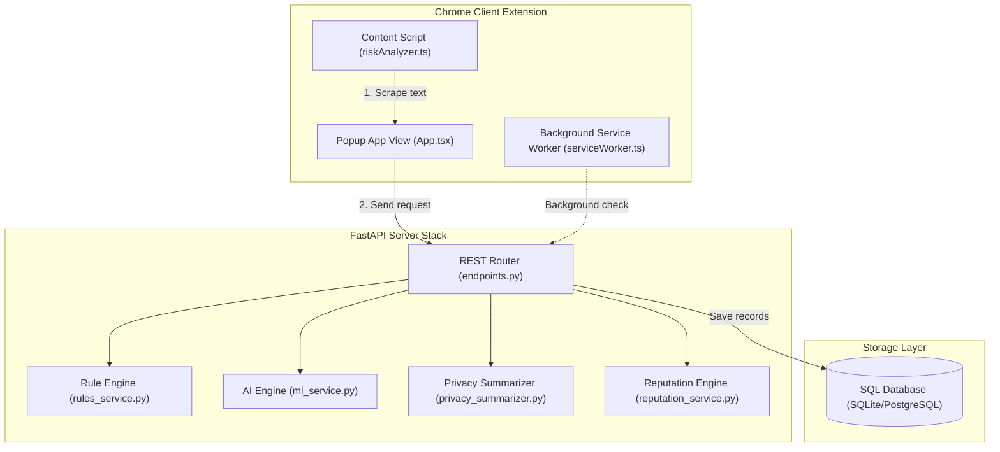
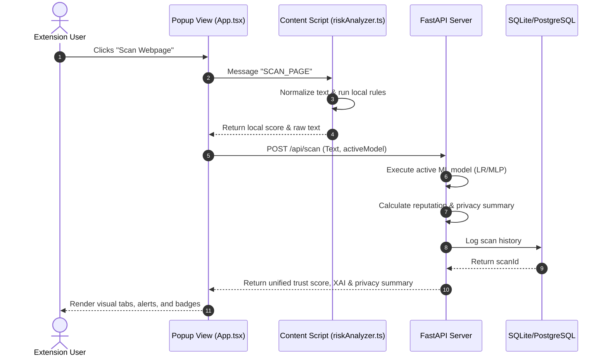
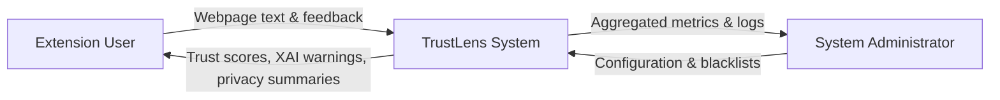
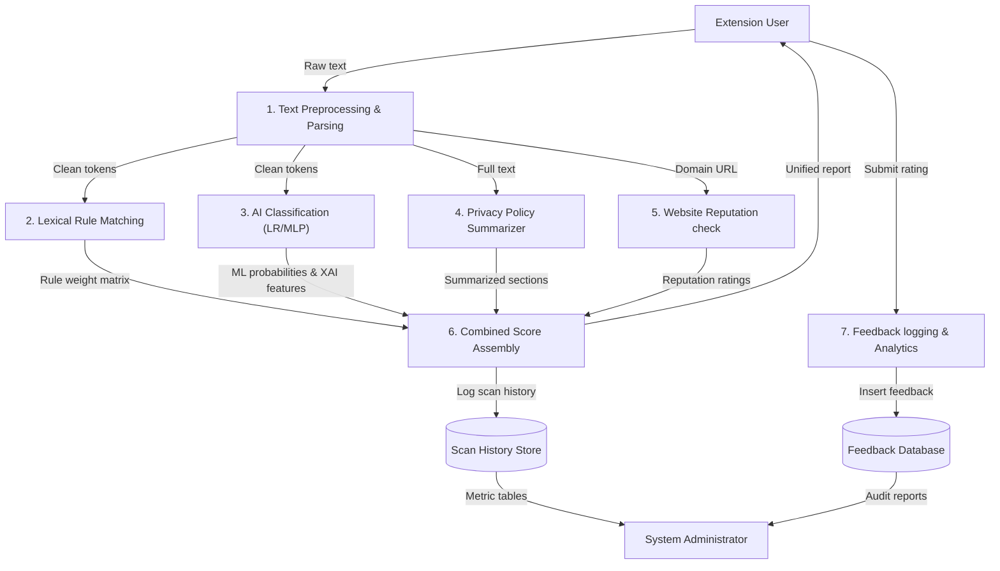
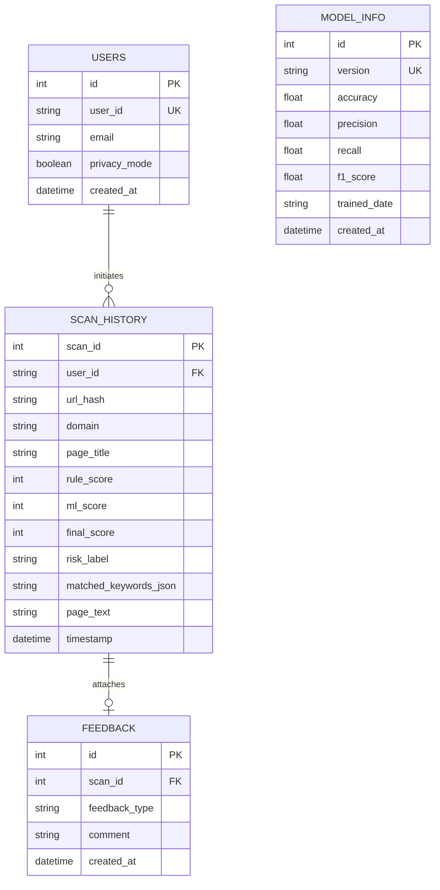
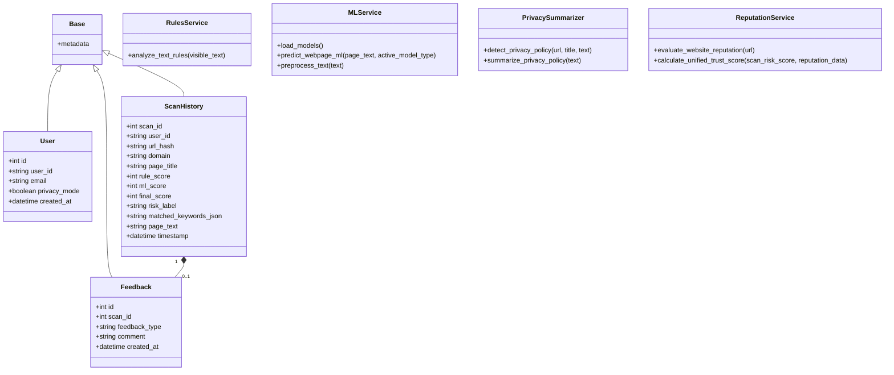
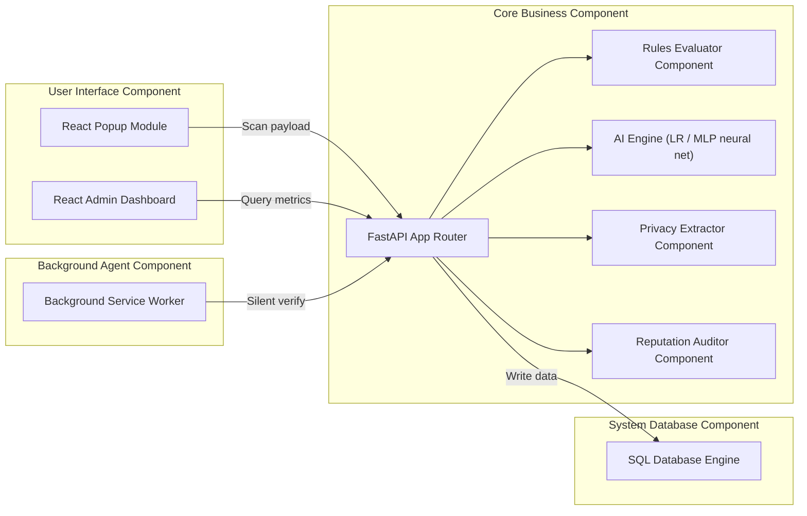
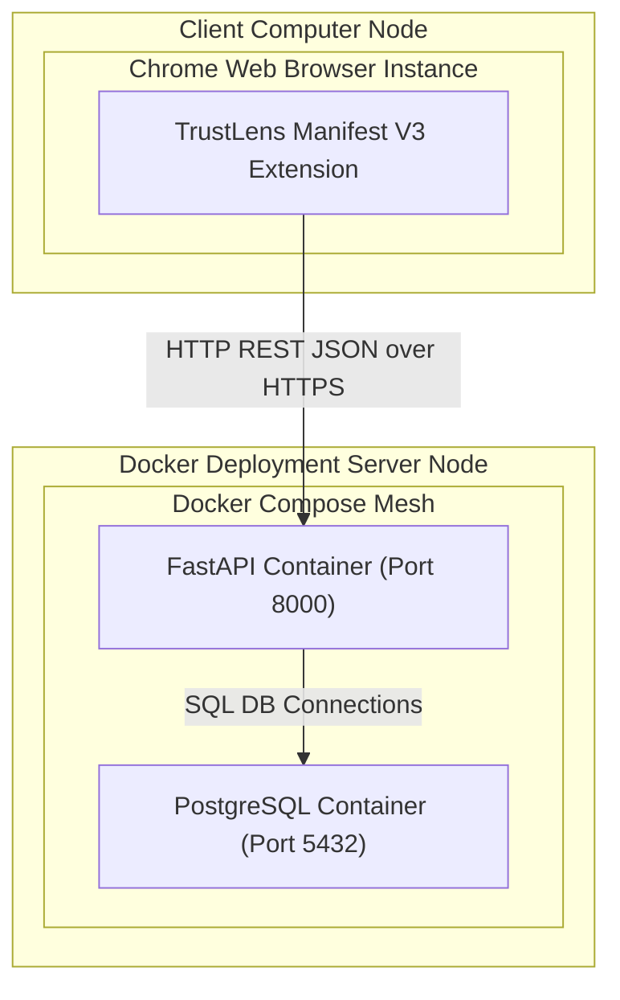

# TrustLens PowerPoint Presentation & Visual Diagrams

This guide compiles presentation outlines and UML diagrams to help demonstrate the TrustLens architecture, system components, database schemas, and processes.

---

## 1. PowerPoint Presentation Outline

*   **Slide 1: Title Slide**
    *   **Header**: TrustLens: Intelligent Webpage Manipulation and Dark Pattern Detection
    *   **Footer**: Academic Final-Year Project Presentation
    *   **Content**: Project Scope, Author Details, Technical Supervisors.
*   **Slide 2: The Problem Statement**
    *   **Header**: The Rise of Deceptive Web UI (Dark Patterns)
    *   **Points**:
        *   Standard consumers are constantly exposed to artificial urgency and scarcity traps.
        *   Privacy terms are intentionally long and complex, obscuring third-party tracking.
        *   Existing security software detects malware but ignores psychological manipulation.
*   **Slide 3: Project Objectives**
    *   **Header**: TrustLens Objectives
    *   **Points**:
        *   Develop Manifest V3 extension providing real-time local and cloud scan diagnostics.
        *   Combine rule-based Lexical analysis with Machine Learning (Logistic Regression & MLP Classifier).
        *   Generate human-readable explanations (XAI) and summarize privacy terms.
        *   Provide system alerts for suspicious and blacklisted sites.
*   **Slide 4: System Architecture**
    *   **Header**: Dual-Engine (Hybrid) System Architecture
    *   **Content**: Explain Local vs Cloud vs Hybrid settings, and data flows between content scripts, service workers, FastAPI, and SQLAlchemy databases.
*   **Slide 5: Machine Learning and Model Tuning**
    *   **Header**: AI Classifier & Evaluation Results
    *   **Points**:
        *   Logistic Regression & MLP Classifier comparison.
        *   Evaluation metrics: 100% accuracy on standard tests with zero False Positives.
        *   Dynamic resource tracking: Latency (0.002ms) and Memory footprints.
*   **Slide 6: Explainable AI & Privacy Highlights**
    *   **Header**: Transparency & Trust Focus
    *   **Points**:
        *   Feature attribution: top 5 keywords contributing to risk classification.
        *   Rule-based sentence extraction summarizing cookie sharing, data retention, and user rights.
*   **Slide 7: Admin Analytics Panel**
    *   **Header**: Central Security Console
    *   **Points**:
        *   Aggregated scan histories, average risk rating, blacklist statuses, and top dark patterns.
*   **Slide 8: Conclusion & Future Scope**
    *   **Header**: Conclusion
    *   **Points**: Integrate real WHOIS lookup endpoints and support ONNX web browser model execution.

---

## 2. Mermaid Visual UML Diagrams

### A. System Architecture Flowchart


### B. Use Case Diagram
```mermaid
usecaseDiagram
    actor User as "Extension User"
    actor Admin as "System Administrator"

    User --> (Scan Active Webpage)
    User --> (Toggle Background Scanning)
    User --> (Change Active AI Model)
    User --> (View Privacy Summary)
    User --> (View Trust Score & Reputation)
    User --> (Submit Classification Feedback)

    Admin --> (View Admin Dashboard)
    Admin --> (Inspect Scan Metrics & Charts)
    Admin --> (Review User Feedback Logs)
    Admin --> (Manage Blacklisted Domains)
```

### C. Sequence Diagram (Page Scan Loop)


### D. Data Flow Diagram (DFD) Level 0


### E. Data Flow Diagram (DFD) Level 1


### F. Entity-Relationship Diagram (ERD)


### G. Class Diagram (Backend API architecture)


### H. Component Diagram


### I. Deployment Diagram

